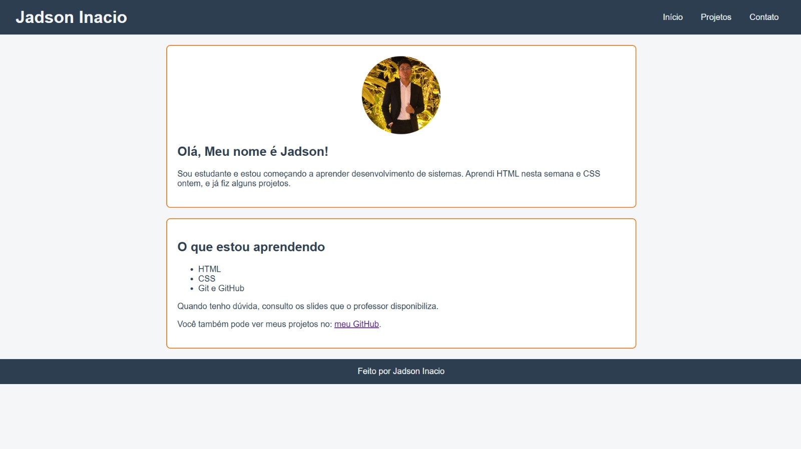
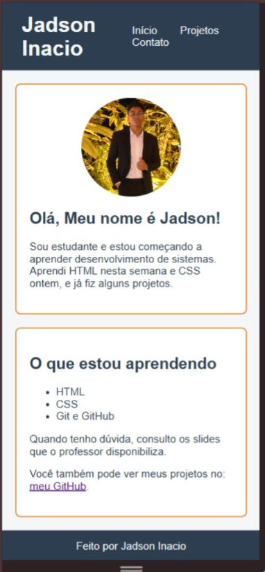

# Olá, eu sou Jadson!

Tenho 16 anos, moro em Jaboatão dos Guararapes-PE e estou cursando o 1º ano do ensino médio, além de fazer o curso Técnico em Desenvolvimento de Sistema. Gosto de tecnologia, programação e jogos, e meu objetivo é me tornar um desenvolvedor de software.

Este site é meu portfólio pessoal e foi meu primeiro projeto completo utilizando HTML e CSS, desenvolvido individualmente durante as aulas.

## Sobre o projeto

O portfólio possui três páginas principais:

- **Início:** onde me apresento e falo um pouco sobre mim.
- **Projetos:** onde apresento os trabalhos que já desenvolvi.
- **Contato:** onde disponibilizo um formulário para que as pessoas possam entrar em contato comigo.

## Tecnologias utilizadas

O projeto foi desenvolvido utilizando:

- HTML5;
- CSS3;
- Tags semânticas;
- Flexbox;
- Variáveis de cores;
- Efeitos de hover no menu;
- Layout responsivo para celulares.

Também utilizei o Git para versionar o código e o GitHub para armazenar o projeto.

## Como executar o projeto

Para visualizar o site no computador, basta clonar o repositório utilizando o comando:

```bash
git clone https://github.com/Jadson70/Portf-lio-Jadson-Inacio.git
```

Depois, abra o arquivo `index.html` no navegador e navegue pelas páginas através do menu.

## Prévia do site

**Visualização no computador:**



**Visualização no celular:**



## O que aprendi durante o desenvolvimento

Durante a criação do projeto, aprendi bastante sobre como o HTML organiza o conteúdo de uma página e como o CSS permite personalizar sua aparência. Também entendi melhor conceitos como variáveis de cores, Box Model e Flexbox.

Uma das minhas maiores dificuldades foi desenvolver a página `contato.html`, principalmente na organização e estruturação do formulário que permite às pessoas entrarem em contato comigo. Precisei testar e ajustar alguns elementos até conseguir chegar ao resultado desejado.

Além disso, aprendi a utilizar commits no Git para registrar as etapas do desenvolvimento, o que ajudou a organizar melhor o trabalho.

Ainda tenho muito a aprender, mas fico satisfeito por conseguir concluir meu primeiro portfólio completo e colocar em prática os conhecimentos adquiridos nas aulas.

## Contato

Se quiser conhecer meus projetos, trocar uma ideia ou deixar alguma sugestão, entre em contato pela página de contato do site ou pelo meu GitHub:

**GitHub:** [@Jadson70](https://github.com/Jadson70).